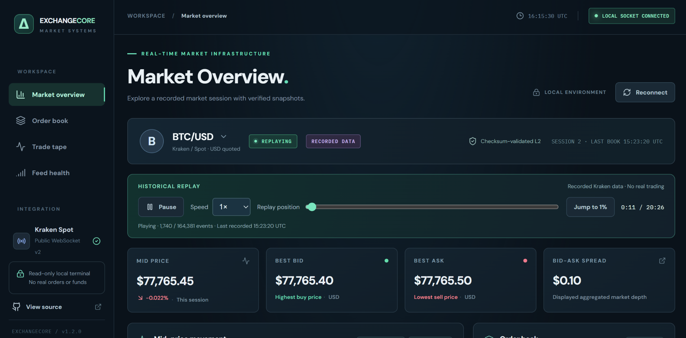
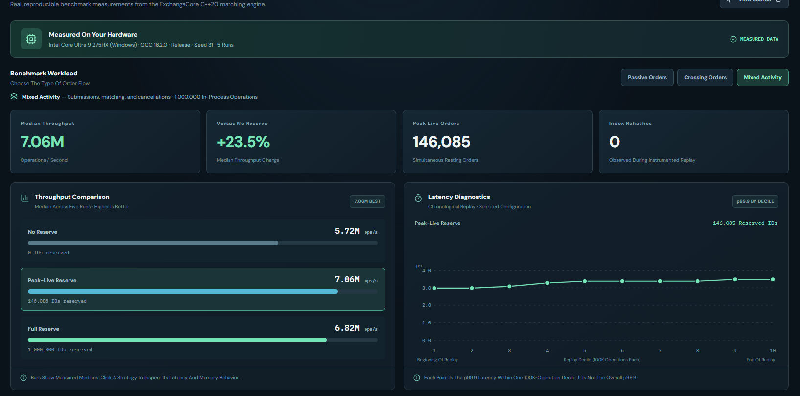

# ExchangeCore

**High-Performance C++ Matching Engine · Verified Market Data · Interactive Engineering Terminal**

ExchangeCore is a portfolio-grade software engineering project with two deliberately separate systems:

- **Simulated exchange core:** a C++20 limit-order book with price-time-priority matching, partial fills, cancellations, correctness tests, and reproducible latency/throughput benchmarks.
- **Real market-data infrastructure:** a read-only Python service that collects public Kraken spot L2 and trade messages, validates order-book CRC32 checksums, records JSONL captures, and serves a local React/TypeScript dashboard with historical replay.

**No real orders or funds are involved.** ExchangeCore does not connect its C++ engine to Kraken execution, reconstruct individual exchange queue positions, or claim to predict profitable trades.



*Market Overview — example screenshot from a local Kraken feed session on November 2, 2026. Prices are historical, not current quotes.*

## Engineering Results

The **Engine Performance** workspace visualizes measured, archived results from one Windows system (Intel Core Ultra 9 275HX, GCC 16.2.0 Release, seed 31). Each workload contained 1,000,000 in-process operations; throughput is the median of five measured runs.

| Deterministic workload | No reservation | Best measured reservation configuration | Relative gain |
|---|---:|---:|---:|
| Passive (resting orders) | 5.56M ops/s | 7.26M ops/s | +30.5% |
| Crossing (aggressive matching) | 7.06M ops/s | 7.92M ops/s | +12.1% |
| Mixed (submission and cancellation) | 5.72M ops/s | 7.06M ops/s | +23.5% |

**Benchmark caveats:** These are local in-process results, **not** network round-trip times, exchange execution latency, financial returns, or universal performance guarantees. The best reservation setting differs by workload. The UI shows latency from a *separate instrumented replay*, including chronological p99.9 diagnostics; latency and throughput were not collected in the same run. Replay checksums agree across the tested configurations. Read [the full methodology](docs/engine-performance-v1.3.md) and [archived source CSVs](benchmarks/snapshots/v0.7/).



*Engine Performance — frozen benchmark snapshot from the v0.7 experiment, not live Kraken latency.*

## What You Can Explore

| View | What it demonstrates |
|---|---|
| Market Overview | BTC/USD and ETH/USD live or recorded bid/ask levels, spread, midpoint history, recent exchange trades and feed health |
| Historical Replay | Pause, resume, change speed, and seek through a **locally saved, validated** Kraken recording |
| Engine Performance | Compare deterministic workloads, order-ID reservation strategies, throughput, replay tail latency, rehash counts and methodology |

The **Market Overview** needs the local Python WebSocket server. The **Engine Performance** workspace works offline from archived measurements and does not require Kraken connectivity.

## Quick Start (Windows / VS Code PowerShell)

These commands run **different components** of ExchangeCore. The React dashboard and the Python WebSocket server run in **separate terminals**. Use the **project root** (`ExchangeCore-Final`, or wherever you cloned the repository) unless a command explicitly enters `dashboard/`.

**Prerequisites:** Python 3, Node.js (Vite-compatible version), npm. Building the C++ engine additionally requires CMake and a C++20 compiler. You can view the **Engine Performance** page without starting Kraken or compiling C++: its data comes from archived benchmark CSVs.

### Command Reference

| Command | What it does | Internet required? |
|---|---|---|
| `npm.cmd run dev` (inside `dashboard/`) | Starts the local React/Vite development site at `http://127.0.0.1:5173` | No after dependencies are installed |
| `py -m market_data.stream_server --symbols BTC/USD ETH/USD --duration 1800 --linger 60` | Connects to **live Kraken** public data for BTC/USD and ETH/USD, validates books, records events locally, and serves them on `ws://127.0.0.1:8765` | Yes |
| `py -m market_data.stream_server --replay <file.jsonl> --symbols BTC/USD ETH/USD --depth 10 --speed 1` | Serves **a previously recorded real Kraken session** to the dashboard, with replay controls | No |
| `py -m market_data.stream_server --replay market_data/fixtures/synthetic-fixture.jsonl --symbols BTC/USD --depth 10 --speed 1` | Runs a **one-event synthetic smoke test** of the replay pipeline; not a meaningful market-history chart | No |
| `py -m market_data.replay <file.jsonl>` | Validates a recording **offline** without starting the dashboard server | No |
| `./scripts/verify_release.ps1` | Runs the local Python tests, fixture validation, C++ build/CTest, frontend production build and frontend unit tests | No after dependencies are installed |
| `npm.cmd run build` (inside `dashboard/`) | Produces the optimized frontend files in `dashboard/dist/`; it does **not** start the dashboard | No after dependencies are installed |

**Port rule:** Only run **one** `market_data.stream_server` process at a time; live and replay modes both bind local port **8765**. Stop one with `Ctrl+C` before starting the other. The Vite web interface runs separately on port **5173**. Both ports are local-only by default.

### 1 — Start the Dashboard (Terminal A)

```powershell
cd "$HOME\Projects\ExchangeCore-Final"  # Replace with your clone directory if different
py -m pip install -r market_data/requirements.txt
cd dashboard
npm.cmd install
npm.cmd run dev
```

Open **http://127.0.0.1:5173** for Market Overview, or **http://127.0.0.1:5173/#performance** for the Engine Performance workspace. The performance page uses frozen measurements and **does not need a running market-data server**.

### 2 — Choose One Market-Data Mode (Terminal B)

Open **another** VS Code PowerShell terminal in the project root, and choose **exactly one** of the options below.

**Option A — LIVE prices from Kraken (recommended for a live demo):**

```powershell
cd "$HOME\Projects\ExchangeCore-Final"
py -m market_data.stream_server --symbols BTC/USD ETH/USD --duration 1800 --linger 60
```

`--symbols` selects markets; `--duration 1800` captures up to **30 minutes** of exchange messages; `--linger 60` keeps the local stream available briefly afterward. The collector saves local `kraken-*.jsonl` files under `market_data/records/` (ignored by Git). **Prices shown in live mode are real exchange quotes, not simulated trades from the C++ matching engine.**

**Option B — Replay a REAL Kraken recording (best for testing pause, seek, and charts):**

```powershell
cd "$HOME\Projects\ExchangeCore-Final"

$capture = Get-ChildItem 'market_data/records/kraken-*.jsonl' -ErrorAction SilentlyContinue |
    Sort-Object LastWriteTime -Descending |
    Select-Object -First 1

if (-not $capture) { throw 'No real recordings found in market_data/records. Capture live data first or supply the path to a backed-up kraken-*.jsonl file.' }

py -m market_data.stream_server --replay $capture.FullName --symbols BTC/USD ETH/USD --depth 10 --speed 1
```

`--replay` loads the chosen local JSONL file, `--depth 10` selects ten price levels, and `--speed 1` plays at **1× recorded speed**. The dashboard labels it **Recorded Data / Replaying**. When starting from a clean clone, this folder may contain no real recordings, because raw captures are deliberately excluded from Git. You can use an archived capture from your backup instead: replace `$capture.FullName` with its full path in quotation marks.

**Option C — Replay the SYNTHETIC test fixture (only checks connectivity):**

```powershell
cd "$HOME\Projects\ExchangeCore-Final"
py -m market_data.stream_server --replay market_data/fixtures/synthetic-fixture.jsonl --symbols BTC/USD --depth 10 --speed 1
```

**Important:** This fixture intentionally contains **one validated snapshot** at an invented BTC price near $50,000. It ends immediately, contains **no trade stream or price history**, and leaves the mid-price chart with insufficient observations. This is **expected**; do not mistake it for a broken dashboard or real exchange pricing. For a full trading-activity demonstration, use Option A or B.

### 3 — Validate a Recording without Opening the Dashboard (optional)

```powershell
cd "$HOME\Projects\ExchangeCore-Final"
py -m market_data.replay market_data/fixtures/synthetic-fixture.jsonl --symbols BTC/USD
```

To verify your **real** recording, replace the fixture filename with the `kraken-*.jsonl` path. This checks replay integrity; it does not launch a WebSocket server.

### 4 — Final Automated Release Checks

```powershell
cd "$HOME\Projects\ExchangeCore-Final"
.\scripts\verify_release.ps1
```

The script verifies Python tests, a synthetic replay, the C++ Release build, registered CTest suites, the production TypeScript/Vite build, and frontend unit tests. **A green result does not replace the manual browser smoke test or GitHub Actions checks.** See [Final Release QA](docs/release-qa.md).

## C++ Build and Reproducible Verification

Example for **MSYS2 UCRT64 GCC** in Windows PowerShell, from the project root:

```powershell
$env:Path = 'C:\msys64\ucrt64\bin;' + $env:Path
cmake -S . -B build-release-check -G 'MinGW Makefiles' -DCMAKE_BUILD_TYPE=Release -DCMAKE_CXX_COMPILER='C:/msys64/ucrt64/bin/g++.exe' -DCMAKE_MAKE_PROGRAM='C:/msys64/ucrt64/bin/mingw32-make.exe'
cmake --build build-release-check
ctest --test-dir build-release-check --output-on-failure
py -m unittest discover -s market_data/tests -v
cd dashboard
npm run build
npm run test:unit
```

Or, with dependencies already installed, run the included comprehensive check from the project root:

```powershell
.\scripts\verify_release.ps1
```

See [Final Release QA](docs/release-qa.md) for manual disconnection, replay, UI and GitHub Actions checks.

## System Architecture

```text
Public Kraken WebSocket v2 (L2 + trade events)    Local JSONL recordings
                      |                                   |
         Python decimal-safe book + CRC32        Checked replay parser
                      |                                   |
                Session reset / health / verified updates
                                  |
                        Local WebSocket hub
                        ws://127.0.0.1:8765
                                  |
                         React / TypeScript UI
                          (live / replay views)

    Separately: C++20 matching engine -> deterministic benchmarks ->
       archived CSVs -> generated JSON -> Engine Performance view
```

The two pipelines are intentionally separated so live WebSocket/network activity cannot distort the in-process C++ benchmarks. Learn more in [Design](docs/design.md), [Market Feed](docs/live-feed-v0.9.md), [Live Stream](docs/live-stream-v1.0.md), and [Historical Replay](docs/replay-v1.2.md).

## Project Scope, Limitations and Attribution

- **Depth:** Public Kraken L2 is aggregated by price level. It does not reveal individual queue priority or all liquidity across venues.
- **Replay:** Replays use source and local receipt timestamps and reconstruct checksum-verified books; gaps in collection are not magically filled. Recorded files over the in-memory replay limit cannot be opened with the current player.
- **Benchmark:** 1M-operation deterministic workloads do not capture networking, risk limits, real capital, multi-venue routing or production SLAs.
- **Presentation:** Live exchange data may be subject to provider display/redistribution restrictions. The server is local-only and this repository does **not** publicly redistribute user-captured Kraken data.
- **Security:** The current local server is read-only. Do not expose port 8765 to the public internet.

More: [Demo Walkthrough](docs/demo-walkthrough.md) · [Release QA](docs/release-qa.md) · [Benchmarking](docs/benchmarking.md).

## Status

**Portfolio release candidate — v1.3.0.** Feature development is frozen for this initial milestone. Local verification on Windows passed (21 Python tests, 7 CTest suites, frontend production build, and 12 frontend unit tests), and live/real-recorded dashboard smoke tests were demonstrated. **GitHub Actions, reviewed merge into `main`, and release tagging still require confirmation.** See [Release QA](docs/release-qa.md).
